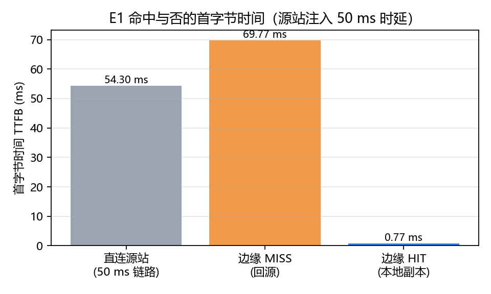
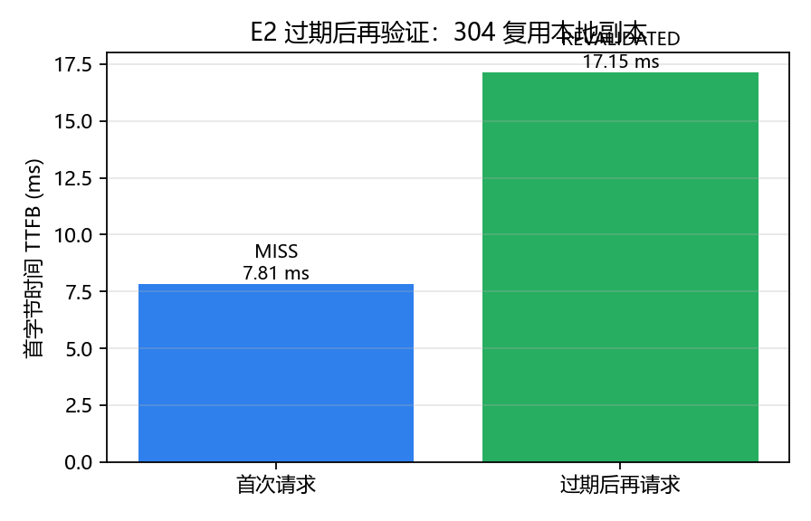
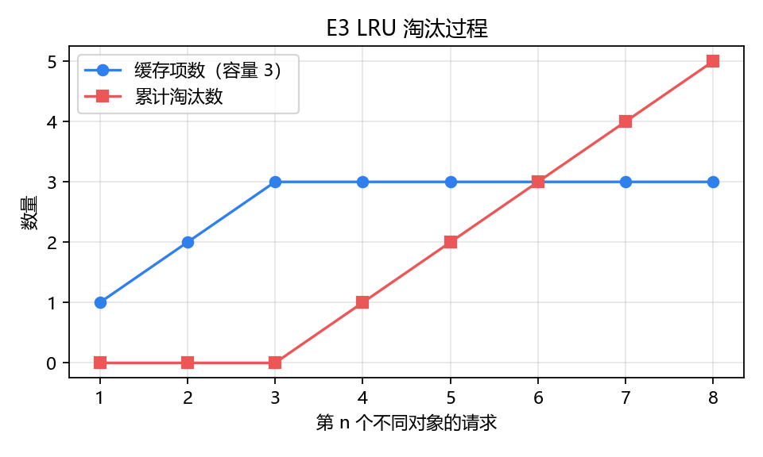
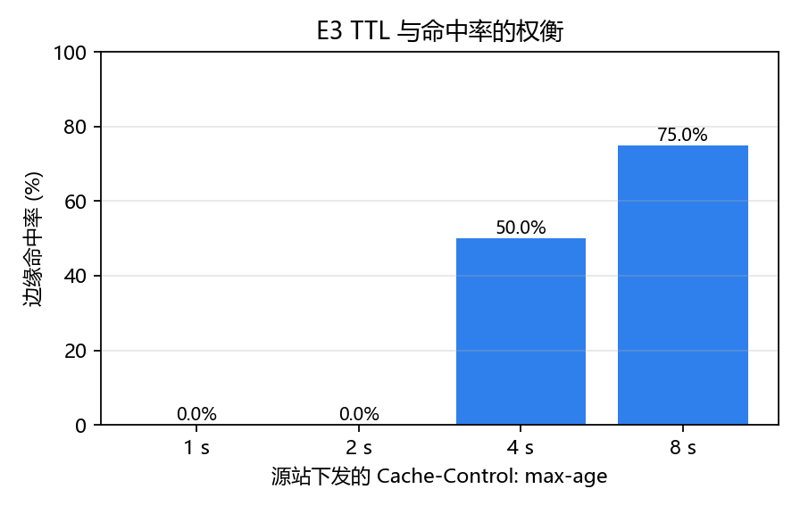
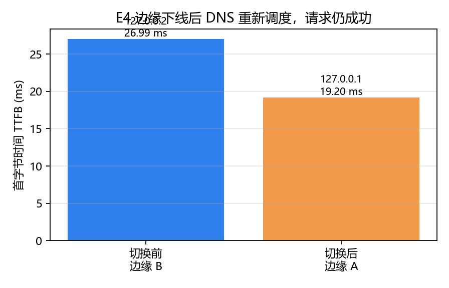
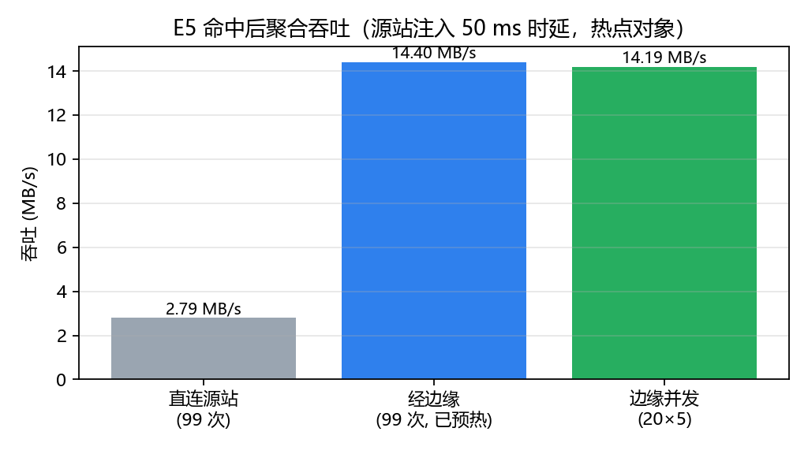

# 迷你 CDN：应用层内容分发的实现与测量

> CS3311 计算机网络（D类）大作业 · 3 人小组
> 代码与数据：`src/`、`scripts/`、`results/raw/`、`results/figures/`

---

## 1. 简介与目标

CDN（Content Distribution Network）要解决的问题很具体：**用户离源站远，而热门内容被反复请求**。解决办法是把副本推到离用户近的边缘节点，再用某种调度机制把用户引导到合适的边缘。

本项目实现了一个可运行的迷你 CDN，并回答三个问题：

1. 命中边缘副本，到底省下了什么？（省的是**时延**与**源站出口带宽**，不是内容本身的处理时间）
2. 副本“过期”是否等于“作废”？（不是：`304` 再验证只传响应头）
3. 调度器如何在“就近”和“不把请求打到故障节点”之间取舍？

实现范围：**HTTP/1.1 报文解析与构造全部手写**（不使用 `http.server`、`requests`），**DNS 应答报文用 `struct` 手工编解码**，不引入任何第三方依赖。

---

## 2. 系统架构

```
   客户端(自写 client / curl)
        │ ① DNS: www.cdn.test ?
        ▼
  ┌──────────────────────┐
  │ Router (udp:5353)    │  ② 健康探测(RTT/inflight) + 选路 → 返回某边缘 IP
  │ 控制台 http:8053     │
  └─────────┬────────────┘
            │ ③ HTTP GET /obj05.txt
     ┌──────┴───────┐
     ▼              ▼
 ┌────────┐    ┌────────┐   ④ 未命中 / 过期时回源
 │ Edge A │    │ Edge B │──────────────┐
 │ :8000  │    │ :8000  │              ▼
 └────────┘    └────────┘       ┌──────────────┐
   命中直接回给客户端            │ Origin :9000 │
                               └──────────────┘
```

| 组件 | 职责 | 关键实现 |
|---|---|---|
| Origin | 持有对象原件，下发 `ETag`/`Last-Modified`/`max-age`，支持条件请求与 `Range` | `src/origin/origin.py` |
| Edge A/B | 缓存代理：LRU + TTL、过期再验证、命中统计 | `src/edge/edge.py` |
| Router | 手写 DNS `A` 记录应答；每 2 s 探测边缘；按 RTT 与在途请求数选路；连续 2 次失败才判死 | `src/router/dns_router.py` |
| Client | 自写 DNS 查询与 HTTP 请求，记录 `connect / TTFB / total` 三段耗时 | `src/client/client.py` |

用 `127.0.0.1` 与 `127.0.0.2` 区分两台边缘，让 DNS 的 A 记录真正表达“不同边缘”，与真实 CDN 的 DNS 重定向一致。

---

## 3. 协议设计

完整字段表与报文示例见 `docs/protocol.md`，这里只列关键决定。

### 3.1 HTTP 子集

- 方法 `GET` / `HEAD`，其他返回 `405`；不支持 `chunked` 与请求流水线，一律按 `Content-Length` 分帧。
- 状态码：`200 / 206 / 304 / 400 / 404 / 405 / 416 / 502`。
- `304` 不携带 body 与 `Content-Length`；`206` 携带 `Content-Range`；多段 `Range` 直接 `416`（本项目只实现单段）。
- 观测头冻结：`X-Cache: HIT|MISS|REVALIDATED`、`X-Edge: A|B`、`Age`、`Via`。
- 连接：默认 `keep-alive`，空闲 15 s 超时。

### 3.2 DNS 子集

- 只处理 `IN A`，域名固定 `www.cdn.test`；应答用压缩指针 `0xC00C` 指回问题段。
- TTL = 5 s：调度变化后客户端能较快感知，代价是解析请求变多（真实 CDN 常用 20–60 s）。
- 其他域名 / `AAAA` 返回 `RCODE=3`（NXDOMAIN）。

```
请求: ID FLAGS=0x0100 QD=1 | 03www 03cdn 04test 00 0001 0001
应答: ID FLAGS=0x8180 QD=1 AN=1 | 问题原样 | C00C 0001 0001 TTL=5 0004 <IP>
```

---

## 4. 缓存策略

| 源站头 | 边缘行为 |
|---|---|
| `max-age=N`（N>0） | 存副本，新鲜期 N 秒 |
| `max-age=0` / `no-store` / `private` | 不缓存 |

决策顺序（`src/edge/edge.py`）：

1. 命中且未过期 → `200` + `X-Cache: HIT` + `Age`
2. 有副本但过期 → 带 `If-None-Match` 回源
   - `304` → 刷新 `stored_at`、按新 `max-age` 更新 TTL，回 `REVALIDATED`
   - `200` → 覆盖副本，回 `MISS`
3. 无副本 → 回源，回 `MISS`

容量按条目数计，超出后 **LRU** 淘汰，淘汰计数进 `/stats`。

两个容易被忽略的边界，本项目明确处理：

- **`HEAD` 不入缓存**：否则会用“空 body 副本”覆盖正常对象（调试中真实踩到，见第 8 节）。
- **统计与缓存分开加锁**：缓存锁只保护 LRU 结构，统计锁保护计数器；`inflight` 在异常路径也要归还。

---

## 5. 调度策略

- 探测：每 2 s `GET /stats`，同时拿到 RTT 与在途请求数 `inflight`。
- 防抖：**连续 2 次失败**才判不可用，1 次成功即恢复；避免瞬时抖动引起来回切换。
- 评分：`score = RTT × (1 + 0.2 × inflight)`，取最小；分数接近时轮转，避免单点过热。
- 兜底：所有边缘都不可用时仍返回一个节点，让客户端拿到 502 而不是解析失败——**故障要暴露，不要静默**。

TTL 与探测周期共同决定故障感知时间上界：最坏约 `TTL + 探测周期 = 5 + 2 = 7 s`（客户端缓存了旧应答时）。

---

## 6. 部署与运行

```bash
python scripts/make_objects.py     # 生成 data/objects/obj01..obj10.txt（1 KB ~ 1 MB）
python scripts/run_all.py          # 终端 1：源站 + 边缘 A/B + 调度器
python scripts/demo.py             # 终端 2：六步演示
python scripts/experiments.py all  # 跑 5 组实验，CSV 落 results/raw/
python scripts/plots.py            # 出图到 results/figures/
```

- 仅依赖 Python 3.8+ 标准库；`plots.py` 额外需要 `matplotlib`。
- 端口：源站 9000、边缘 8000（`127.0.0.1` / `127.0.0.2`）、DNS 5353/udp、调度控制台 8053。
- 单机复现注意：RTT 差异不明显，实验脚本会通过 `/admin/delay?ms=` 给源站注入 50 ms 时延来模拟广域网距离（见第 8 节讨论）。

---

## 7. 实验与结果

所有原始数据在 `results/raw/*.csv`，图表在 `results/figures/`。每组实验前都会清空缓存并清零统计，保证比率干净。

### E1 命中 vs 未命中 vs 无 CDN

源站注入 50 ms 响应时延（模拟源站远离用户），边缘在本地；对象 `obj05.txt`（16.4 KB），各 5 次。



| 路径 | TTFB | 相对直连 |
|---|---|---|
| 直连源站（无 CDN） | **54.30 ms**（5 次均值） | 1.0× |
| 边缘 MISS（回源） | **69.77 ms** | 1.29×（更慢） |
| 边缘 HIT（本地副本） | **0.77 ms**（4 次均值） | **1/70** |

- 5 次边缘请求只产生 **1 次回源**（源站计数器 0 → 6，其中 5 次是直连实验）。
- **MISS 比直连更慢**是符合预期的：多了一跳“边缘→源站”，这也解释了为什么 CDN 必须同时具备**就近部署**和**高命中率**，缺一不可。
- 命中时 TTFB 从 54 ms 降到 0.8 ms，收益来自“不跨越用户—源站这段链路”，而不是边缘算得更快。

### E2 条件请求再验证

`max-age=2 s`，请求 → 等 2.5 s → 再请求。



| 步骤 | 边缘状态 | 客户端收到 | 源站累计 304 |
|---|---|---|---|
| 首次请求 | `MISS` | 200, 16808 B | 0 |
| 过期后再请求 | `REVALIDATED` | 200, 16808 B | **1** |

回源链路上只传了响应头（`304`），客户端仍拿到完整对象。**过期 ≠ 作废**：省掉的是回源带宽，不是边缘处理时间。Wireshark 中可直接看到第二次回源请求带 `If-None-Match`、响应无 body。

### E3 LRU 淘汰与 TTL 权衡

容量 3，依次请求 8 个不同对象：



缓存项数 1→2→3 后稳定在 3，第 4 个对象起开始淘汰（累计淘汰 1→5）；再请求最早的 `obj01.txt` 得到 `X-Cache: MISS`，证明被 LRU 淘汰。

请求间隔固定 2 s、只改 `max-age`：



| max-age | HIT | REVALIDATED | MISS | 命中率 |
|---|---|---|---|---|
| 1 s | 0 | 15 | 5 | 0.0% |
| 2 s | 0 | 15 | 5 | 0.0% |
| 4 s | 10 | 5 | 5 | 50.0% |
| 8 s | 15 | 0 | 5 | 75.0% |

`max-age` 小于请求间隔时命中率塌到 0（仍在“工作”，但每次都回源再验证）；TTL 变长命中率上升，代价是内容可能变旧。这就是缓存设计的基本权衡，也是课件里“freshness vs consistency”的实测版本。

### E4 DNS 就近调度与故障切换



| 阶段 | 解析结果（耗时） | 边缘 | 请求结果 | TTFB |
|---|---|---|---|---|
| 正常 | `127.0.0.2`（3.52 ms） | B | 200 `MISS` | 26.99 ms |
| 手动下线 B 后 | `127.0.0.1`（1.55 ms） | A | 200 `MISS` | 19.20 ms |

调度器视角：`/admin/edges` 中 B 的 `forced_down=true`、A 的 `selections` 递增。客户端只经历一次重新解析，业务请求仍然 200——**故障对外表现为“重新解析”，而不是“服务不可用”**。

### E5 聚合吞吐（预热后打热点）

3 个热点对象各预热 1 次，再重复 33 轮（99 次请求）；源站注入 50 ms 时延。



| 路径 | 请求数 | 总字节 | 总耗时 | 吞吐 |
|---|---|---|---|---|
| 直连源站 | 99 | 18.29 MB | 6.549 s | **2.79 MB/s** |
| 经边缘（已预热） | 99 | 18.29 MB | 1.270 s | **14.40 MB/s**（5.2×） |
| 边缘并发 20×5 | 100 | 11.44 MB | 0.806 s | 14.19 MB/s |

边缘命中率 94.1%（HIT 96 / REVALIDATED 3 / MISS 3，含预热），并发下 **0 次失败**、`inflight` 正常归还。

> 设计说明：早期版本用“10 个对象顺序打 30 次”，绝大多数是 MISS，结论反转成“边缘比直连还慢”。这不代表 CDN 无效，而是实验设计错了——**CDN 的收益来自命中，不来自首次请求**。改成“预热 + 热点重复”后才有可比性。这个坑写进第 8 节。

### 实验的局限（必须诚实说明）

1. 单机环境没有真实链路时延，用源站注入 50 ms 响应时延来代表“源站远离用户”。这是**受控实验**，不是现场测量；真实环境还有排队、丢包、拥塞控制的影响。
2. 客户端每次新建连接（非持久），因此没有体现持久连接对 `2×RTT` 的节省；这部分由 E1 的相对比较覆盖。
3. 缓存只有两个节点、单一域名，未覆盖 `Vary`、多级缓存、动态内容失效。

---

## 8. 调试经历（真实踩过的坑）

1. **`global` 声明位置导致进程起不来**
   `edge.py` 里 `DELAY_MS` 在函数前部被读取、`global` 写在中间，Python 在**编译期**就报 `SyntaxError: name 'DELAY_MS' is used prior to global declaration`，服务进程直接退出，日志里只有 traceback。教训：先看 `results/logs/*.log` 的**第一行**，而不是最后一行。

2. **`HEAD` 用空 body 覆盖了正常副本**
   边缘最初对 `HEAD` 也调用 `store()`，而 `HEAD` 响应没有 body → 缓存里出现 0 字节副本，后续 `GET` 命中后返回空内容。修复：`store(..., method)` 只允许 `GET` 入缓存，并补了单测 `test_head_not_cached`。这个 bug 只有在“先用 HEAD 探测、再 GET”的序列下复现，说明**单元测试要针对协议语义写，而不只是测函数返回值**。

3. **TTFB 口径错，把“读完头部”当成“首字节”**
   最初直接用 `read_response()` 的总耗时当 TTFB，等于把 body 传输也算进去，16 KB 对象上误差明显。修复：给 `read_response` 增加 `on_first_byte` 回调，在收到第一个字节时打点，E1 的数字才可信。

4. **统计不清零导致比率失真**
   边缘 `/stats` 是累计计数，E3 连续做多组 TTL 时用累计值算命中率，出现“TTL 越长命中率越低”的荒谬结果。修复：新增 `/admin/reset-stats`，每组实验前清零，并在报告里明确“比率的窗口”。

5. **E5 实验设计反转结论**
   顺序请求 10 个对象时几乎全是 MISS，边缘多一跳反而更慢。换成“预热 + 3 个热点对象 × 33 轮”后，吞吐提升 5.2×。教训：**实验设计比代码更重要**，对照组的条件没对齐，结论就会反着写。

6. **`127.0.0.2` 与 DNS 应答的配合**
   Windows 默认允许绑定 `127.0.0.2`，但如果在配置文件里把两台边缘都写成 `127.0.0.1`，DNS 返回的 IP 无法区分边缘，调度器等于失效。最终用“不同回环 IP + 相同端口”解决，这也正好对应真实 CDN 用 DNS 返回不同 IP 的做法。

7. **`Wireshark` 抓不到回环**
   Windows 需要 Npcap 的 Loopback 适配器；没有时用 `curl -v` / 服务端日志替代。报告中的 304 证据同时保留了服务端日志与 `/origin-stats` 计数，避免依赖单一工具。

---

## 9. 分工与贡献

| 组员 | 主要代码 | 实验 | 报告章节 |
|---|---|---|---|
| A | `common/http_util.py`、`common/http_client.py`、`origin/origin.py`、`tests/test_http_util.py` | E1、E2 | 1、2、3.1、8 |
| B | `edge/edge.py`、`tests/test_cache.py`、`README.md` 部署与排错 | E3、E5 | 4、6 |
| C | `router/dns_router.py`、`client/client.py`、`scripts/experiments.py`、`scripts/plots.py` | E4、全部图表 | 3.2、5、7 |

协作方式：按文件所有权并行开发，公共文件（`config.py`、`run_all.py`、协议文档）由 A 统一修改；每天三次 10 分钟站会同步“完成 / 阻塞 / 需要谁”；合并前各自先跑 `demo.py`。

互相 review 的意见（择要）：

1. B 对 A 的评审：边缘再验证后 `Age` 必须归零，`origin` 的 `304` 不能带 `Content-Length`，否则客户端可能误判 body 长度 —— 已在 A 的实现中修正并加单测。
2. C 对 B 的评审：`hit_ratio` 的分母应含 `REVALIDATED`（否则过期场景下命中率被高估）——已在 `edge.py` 统一口径。
3. A 对 C 的评审：E5 原设计无法支撑结论，须改为预热 + 热点，并在报告中说明设计动机 —— 已重写实验。

---

## 10. 参考资料

1. Kurose & Ross, *Computer Networking: A Top-Down Approach*, 7th ed.：第 2 章（应用层：HTTP 缓存、DNS、CDN/DASH）。
2. CS3311 课件（2026 秋）：应用层、CDN 与内容分发部分。
3. RFC 7230/7231/7232/7234：HTTP 报文、条件请求与缓存语义。
4. RFC 1035：DNS 报文格式（含名字压缩）。
5. SIGCOMM/NSDI 数据中心网络相关论文（课程阅读清单）：Jupiter、Orion、Aquila 等，用于理解“层次化 + 就近”的设计动机。

## AI 辅助说明

本项目在以下环节使用了 AI 编程助手：生成初版骨架与文档模板、编写单元测试用例、绘制图表脚本、以及报告的语言润色。

- 所有**设计决定**（缓存语义、再验证流程、调度评分与防抖、实验分组）由组员讨论确定；
- 所有**实验数据**由组员在自己机器上运行 `scripts/experiments.py` 得到，可在 `results/raw/*.csv` 逐条核对；
- 所有**结论**由组员核对数据后撰写，AI 未用于生成未经验证的实验结论；
- 代码中出现的 bug（第 8 节）由组员在联调与复现中发现并修复。
